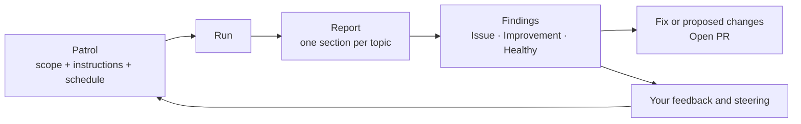

<Info>
  Patrols are in beta.
</Info>

Issues start when an alert fires. Patrols start before that. A Patrol is a check you point at one part of your system, such as a service, a database or your log stream. Each time it runs, Antimetal investigates that part against your telemetry and code, writes a report, and proposes fixes for what it finds.

Use Patrols to answer questions your alerts don't:

- Is checkout healthy enough for Friday's launch?
- Is the orders database running out of connections or storage?
- Which errors are in our logs that no monitor catches?

For ready-made recipes, see [Patrol workflows](/product/patrol-workflows).

## How a Patrol works

- A **Patrol** holds what to check (its template and scope), any extra instructions, and when to run.
- A **run** is one check. It runs on the schedule, or when you select **Run now**.
- A run produces a **report**, with one section for each topic the template covers.
- The report is made of **findings**. Each finding is one of:

| Kind | Means | You get |
| --- | --- | --- |
| **Issue** | Something is broken or degrading now. | A fix. |
| **Improvement** | A gap where nothing is broken yet, such as a missing monitor or shrinking headroom. | Proposed changes. |
| **Healthy** | Checked, and nothing to do. | Evidence that it was checked. |

Every finding links to its evidence: the metrics, logs, traces and code Antimetal looked at.

## Templates

Each Patrol starts from a template. The template decides which topics a run covers and which scope fields you fill in.

| Template | What it checks | Use it when | Looks back |
| --- | --- | --- | --- |
| **Service health check** | A service's latency, error rate, saturation and availability, plus the health of its critical dependencies. | You own a service, or one is on the path of a launch or a recent incident. | 7 days |
| **Database health check** | A PostgreSQL database (RDS, Aurora or Cloud SQL) for connection pressure, storage headroom, replication lag and maintenance debt. | A production Postgres database matters to you and you want warning before it fills up or falls behind. | 7 days |
| **Error sweep** | Your log stream for errors no existing monitor catches. It surfaces anomalies worth knowing about and recommends monitors you should have. | You're not sure your alerts cover what matters. | 4 hours |

**Looks back** is the time window each run reasons over. It counts back from when the run starts.

## Create a Patrol

<Steps>
  <Step title="Open Patrol">
    Go to [Patrol](https://overlook.antimetal.com/patrol) and select **+** (**Create patrol**).
  </Step>
  <Step title="Choose a template">
    Pick one of the templates above.
  </Step>
  <Step title="Set the scope">
    Fill in where the Patrol looks. **Environments** is required and starts as `production`. Depending on the template, you can also set **Services & Components** and **API Endpoints**. Pick from the suggestions or type a name.

    Narrow is better. A Patrol on `checkout-svc` finds more than one on every service.
  </Step>
  <Step title="Add instructions (optional)">
    Use **Additional instructions** to say what matters, such as *"We launch on Friday and expect 5x traffic on POST /checkout"* or *"Ignore the legacy billing service."* Every run follows them.
  </Step>
  <Step title="Set a schedule (optional)">
    Turn on **Recurring schedule** to run it on a cadence. Leave it off to run it only when you select **Run now**. See [Schedules](#schedules).
  </Step>
  <Step title="Create and run">
    Select **Create Patrol**. Antimetal opens the Patrol's page.

    Creating a Patrol does not start a run. Select **Run now** to get the first report straight away, or wait for the schedule.
  </Step>
</Steps>

If you don't rename it, Antimetal names the Patrol for you.

## Schedules

| Option | Runs | Set it with |
| --- | --- | --- |
| **Off** (default) | Only when you select **Run now**. | Leave **Recurring schedule** off. |
| **Simple** | Daily, weekly on a day, or monthly on a date, at a time in your browser's timezone. | **Frequency**, **Day of week** or **Day of month**, and **Time**. |
| **Cron expression** | Any standard 5-field cron, in an IANA timezone. | **Cron** and **Timezone**, for example `0 9-17/3 * * 1-5` and `America/New_York`. |

To change it later, open the Patrol and select **Configure** (the gear). You can also change the scope and the name there.

<Tip>
  Match the schedule to the window. The Error sweep looks back 4 hours, so a run every 4 hours (`0 */4 * * *`) covers every hour once. The health checks look back 7 days, so daily or weekly is enough.
</Tip>

## Read a run

A run is **Queued**, then **Running**, then **Completed** or **Canceled**. A run takes several minutes or more, depending on the scope. Fixes are drafted after the report is ready, so they can appear a little later. You can leave the page while it works.

Each run gets a number, such as `RUN-12`, and an outcome:

| Outcome | Means |
| --- | --- |
| **Healthy** | Nothing needs action. |
| **Flagged** | At least one Issue or Improvement. |
| **Needs review** | Antimetal could not reach a clear answer, often because data was missing. |
| **Failed** | The run did not finish. Run it again, and contact us if it keeps failing. |

The run's report has a one-line verdict, then one section per topic. Each section has its own outcome, key metrics, charts and finding cards, numbered `F1`, `F2` and so on, with Issues first, then Improvements, then Healthy.

Select a finding to open it. The panel shows:

- **Description**: what Antimetal found and why it matters.
- **Fix** (for an Issue) or **Proposed changes** (for an Improvement).
- **Evidence**: the data behind it. Open any item to see the raw query and result.
- **Linked issues** or **Linked improvements**, when the finding became one.

The finding's URL opens the panel directly, so you can share it.

The Patrol's **Overview** sums up its latest run: health, top KPIs and the **Top flagged findings**. **Topics** shows each topic's findings across runs, and **Runs** lists every run. Each run also reads the previous run's findings, so a report says when a problem continues, gets worse or clears up.

## Act on findings

For a finding with a code change, the fix card works like any other [Antimetal fix](/product/fixes):

- **Open PR** or **Open draft PR** opens a pull request on your repo. This needs the [GitHub integration](/integrations/github).
- **Open in Codex**, **Cursor**, **Devin** or **GitHub Copilot** hands the change to your coding agent.
- **Copy fix as prompt** copies it for any other tool.

Antimetal never merges a pull request. If Antimetal investigated and found no code change to make, the panel says so, and the evidence still stands.

When Issues and Improvements are turned on for Patrol findings in your organization, each finding that needs action also becomes an item in your queues, such as `ISS-42` or `IMPR-43`. It then follows the normal [Issue lifecycle](/product/issue-lifecycle). If the same problem is already tracked, the finding joins the existing item instead of creating a new one, and its badge says **Pre-existing**.

## Steer a Patrol

Patrols get better when you tell them what you care about. There are two ways.

**Change its instructions.** Select **Steer** on the Patrol's page and edit **Additional instructions**. Use it for lasting direction: what to focus on, what to ignore, what counts as serious. The **History** list shows each change with a summary of what changed. A change shows as **Implemented** once a run has started with it.

**Give feedback on findings.** At the bottom of each finding, answer **Was this finding helpful?** with a thumbs up or down, and add a comment. Antimetal learns from written feedback across runs, for that Patrol and for your organization. A thumbs up or down without a comment is recorded, but a comment is what teaches it, so say what was wrong or right.

## Get Patrol results in Slack

A run does not post to Slack on its own. To get a recurring summary, turn on the **Patrol digest**:

1. On [Patrol](https://overlook.antimetal.com/patrol), select the bell (**Notifications**).
2. Under **Patrol digest**, choose a channel in **Post to** and set the **Schedule**. The default is Monday at 09:00.
3. Select **Save configuration**. Antimetal joins the channel. Select **Send now** to see a post straight away.

Each post covers the top findings and fixes since the last one, notes what was left out, and says when nothing material changed. The digest needs the [Slack integration](/integrations/slack).

Patrol links pasted into Slack unfurl with the run's outcome.

## Archive and restore

To stop a Patrol, open **Configure** and select **Archive**, or use the row's menu on the Patrol list. Future runs stop, and its runs and reports stay readable under the **Archived** tab. Restore it from the same menu.

## Use Patrols from your coding agent

Every step on this page works through the [Antimetal MCP server](/agents/mcp): create a Patrol, run it, read the report, open a fix, steer it and give feedback. See [Patrol workflows](/product/patrol-workflows#from-your-coding-agent) for prompts, and [MCP tools](/agents/tools#patrols) for each tool.

## FAQ

<AccordionGroup>
  <Accordion title="How is a Patrol different from an alert?">
    An alert fires when a threshold you set is crossed, and starts an [Issue](/product/issue-lifecycle). A Patrol looks on a schedule whether or not anything fired. It finds problems that have no alert yet, and gaps that are not problems yet.
  </Accordion>
  <Accordion title="What data does a Patrol use?">
    The same [integrations](/integrations/overview) as an investigation: your metrics, logs, traces, cloud resources and code. A Patrol can only check what those integrations reach, so connect your observability tools and GitHub first.
  </Accordion>
  <Accordion title="Does a Patrol change anything in my systems?">
    No. A Patrol only reads. Fixes are proposals: you open the pull request, review it and merge it.
  </Accordion>
  <Accordion title="Can I change how far back a Patrol looks?">
    Each template sets its window: 7 days for the health checks, 4 hours for the Error sweep. You can't change it in the app today. From the [MCP server](/agents/mcp), `run_patrol` accepts a different window for a single run.
  </Accordion>
  <Accordion title="Who can create and change Patrols?">
    Any member of your organization.
  </Accordion>
</AccordionGroup>

<Snippet file="need-help.mdx" />
